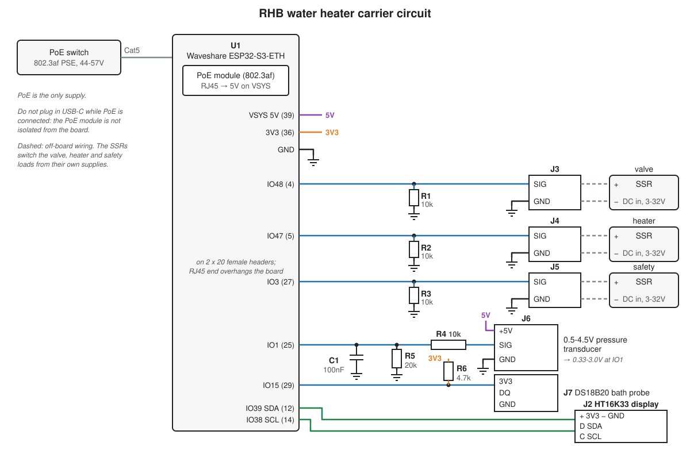

Water Heater Hardware
=====================

[kicad/](kicad/README.md) has the carrier board.

Power
-----

    PoE switch (802.3af)
     |
     +-- Cat5 ---- RJ45 on the ESP32-S3-ETH
                    |
                    PoE module ---- 5V on VSYS (pin 39)
                                     |
                                     +-- ESP32-S3, W5500 (their own 3V3)
                                     +-- pressure transducer, 5V
                                     +-- display, probe, from 3V3

Buy the **ESP32-S3-POE-ETH**, or fit Waveshare's PoE module to an
ESP32-S3-ETH.  With the loads on SSRs it draws a few watts.

- **Never plug in USB-C while PoE is connected.**  A third-party report says
  the PoE module isn't isolated, so USB would join the host's ground to it.
- **Check VSYS before fitting the carrier.**  With PoE connected and nothing
  on the headers, VSYS (pin 39) to GND should read 5V.  If not, move `+5V` to
  the pin that does in `kicad/generate_schematic.py`.

SSR outputs
-----------

Each terminal is `SIG` (the GPIO, 3.3V high) and `GND`, to the SSR's DC
input `+` and `-`.

| Terminal | GPIO | SSR |
| --- | --- | --- |
| J3 `VALVE` | IO48 | Solenoid valve |
| J4 `HEATER` | IO47 | Heater, not driven |
| J5 `SAFETY` | IO3 | Safety shutdown |

R1-R3 (10k to GND) hold the SSRs off while the ESP32 boots.

- **The SSR must turn on at 3.3V**: use one rated 3-32V in, not 4-32V or 5V.
- An SSR wanting more than about 20 mA input needs a transistor in front.
- `SIG` is a bare GPIO: keep the SSR wiring short and away from mains.

IO3 is a strapping pin, but only for JTAG after an eFuse is burned, so the
pull-down doesn't affect boot.

Sensors
-------

### Pressure, J6

0.5-4.5V ratiometric transducer: `+5V`, `SIG`, `GND`.  R4 (10k) and R5 (20k)
scale it by 2/3 for the ADC; C1 (100nF) filters it.  Use 1% resistors.

**Set `PRESSURE_DIVIDER` to 1.5 in `code.py` when this board goes in**, or
pressure reads a third low.

For better than a few PSI, calibrate `PRESSURE_ZERO_V` and `PRESSURE_SPAN_V`
against a gauge (see the comment in `code.py`), and check
`PRESSURE_FULL_PSI` matches the sensor.

### Bath probe, J7

DS18B20, `3V3`, `DQ`, `GND`, powered.  R6 (4.7k) pulls DQ up.  If CRC errors
persist on a long cable, try 2.2k.

### Display, J2

HT16K33 backpack, as on the poof controller: JST-XH `+ - D C` = 3V3, GND,
SDA (IO39), SCL (IO38).  Use 3V3 so the backpack's pull-ups go to 3V3.

Parts
-----

| Qty | Ref | Part |
| --- | --- | --- |
| 1 | U1 | Waveshare ESP32-S3-POE-ETH (or ESP32-S3-ETH plus its PoE module) |
| 2 | U1 | 1x20 female header, 2.54 mm |
| 3 | R1-R3 | 10k, 1/4 W, 5% or better |
| 1 | R4 | 10k, 1/4 W, 1% metal film |
| 1 | R5 | 20k, 1/4 W, 1% metal film |
| 1 | R6 | 4.7k, 1/4 W, 5% or better |
| 1 | C1 | 100nF ceramic, 5 mm pitch |
| 3 | J3-J5 | Phoenix MKDS 1,5/2-5,08 terminal block |
| 2 | J6, J7 | Phoenix MKDS 1,5/3-5,08 terminal block |
| 1 | J2 | JST B4B-XH-A |
| 4 | | M3 standoffs |
| 3 | | DC input SSRs, 3-32V in, sized for their loads (off board) |
