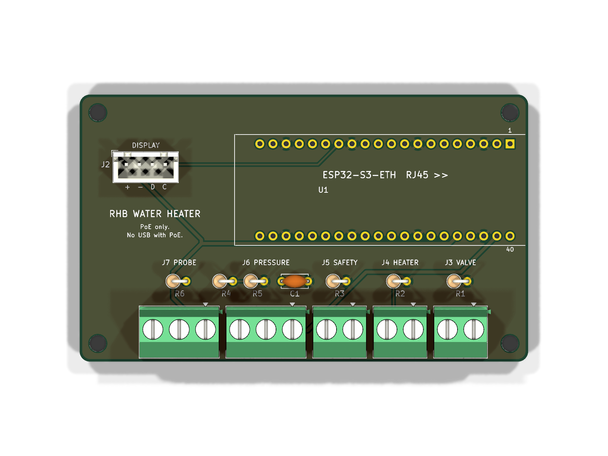
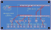

Water Heater Carrier Board
==========================

Two layer, 86.5 x 51.5 mm carrier for the circuit in
[HARDWARE.md](../HARDWARE.md).
Parts: [bom.csv](bom.csv).

- **U1** sits component side up, pin 1 (square pad) top right.  Its RJ45 end
  overhangs the right edge by about 16 mm, clearing the cable and PoE module.
- **Terminals**, along the bottom edge, pin 1 (square pad) on the right:

  | Block | Pins, left to right |
  | --- | --- |
  | J7 `PROBE` | `GND DQ 3V3` |
  | J6 `PRESSURE` | `GND SIG +5V` |
  | J5 `SAFETY`, J4 `HEATER`, J3 `VALVE` | `GND SIG` |

- **J2** is `+ - D C`, matching the backpack.
- Ground is poured on both layers.

Regenerating
------------

Edit the scripts, not the KiCad files, then run `./build.sh`, or
`./build.sh --no-route` to try a layout.  Routing needs Java 17+ and
`~/tools/freerouting-1.9.jar`.

| Expected warning | Why |
| --- | --- |
| `lib_symbol_issues` | Symbols live only in the schematic |
| `extra_footprint` | Mounting holes aren't in the schematic |
